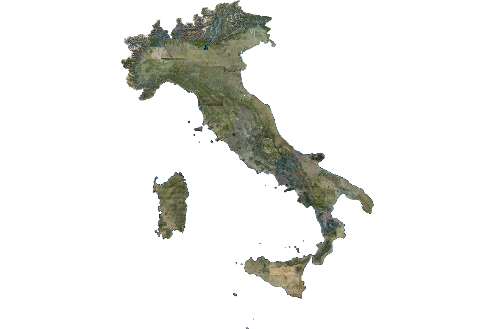

# Italy Aerial Orthophoto

A STAC catalog for the Italian national aerial orthophoto mosaic, published as
a cloud-native Zarr v3 array that any client can read directly from object
storage.



## What is here

One collection.

**[AGEA Orthophoto Mosaic of Italy (2022-2024)](./agea-orthophoto/README.md)** —
every AGEA national orthophoto flight from 2022, 2023 and 2024, merged into
one seamless RGBA grid covering the whole country. EPSG:3857 at 0.597 m per
pixel, `(band, y, x)` `uint8`, twelve pyramid levels down to about 1.2 km per
pixel. Roughly 2.23 million by 2.90 million pixels at full resolution. The
alpha band marks coverage, and about a quarter of the grid carries imagery;
the rest is sea, neighbouring countries and grid padding.

A reader can pull a single city block at 60 cm, or the whole country at 1.2 km,
from the same store, without downloading the dataset and without a tile
server or a GIS stack.

## License

**CC-BY-4.0.** The orthophotos are produced and owned by AGEA and published
under the
[Creative Commons Attribution 4.0 International licence](https://creativecommons.org/licenses/by/4.0/).
MindEarth released the derived Zarr dataset under the same licence.

Credit both. MindEarth's required attribution string is:

> Contains orthophotos © AGEA – Agenzia per le Erogazioni in Agricoltura,
> voli 2022–2024, CC BY 4.0, modified by MindEarth.

AGEA does not endorse the derived dataset. Both the source data and the
derived dataset are provided as is, with no warranty.

## Provenance

**This catalog is a mirror, and it holds metadata only.** The imagery belongs
to AGEA. The Zarr store is MindEarth's work, and Source Cooperative serves it.
This catalog copies no bytes and re-hosts nothing: every data href is an
absolute URL into
[source.coop/mindearth/italy-aerial](https://source.coop/mindearth/italy-aerial).

It syncs by hand. The `updated` field on the catalog and the collection
records the last time a person checked it against the upstream, which was
2026-10-31. Checksums on the two upstream metadata assets will mismatch if
MindEarth republishes, which is the signal to re-check.

Found something wrong? The catalog carries `vcs` and `issues` links to the
repository that generates it. Corrections are welcome as pull requests.

## Access

Source Cooperative serves no directory listing over plain HTTP, so a plain
HTTP Zarr store fails on this dataset. Use an S3-style store, anonymously.

```python
import xarray as xr
from obstore.store import S3Store
from zarr.storage import ObjectStore

store = ObjectStore(
    S3Store(
        "mindearth",
        prefix="italy-aerial/italy-aerial.zarr",
        endpoint="https://data.source.coop",
        region="eu-central-1",
        skip_signature=True,
        virtual_hosted_style_request=False,
    ),
    read_only=True,
)

rgba = xr.open_zarr(store, group="0", consolidated=False)["rgba"]
print(rgba.shape)   # (4, 2899968, 2244608)
```

Read the [catalog agent guide](AGENTS.md) before querying. It carries the
coordinate conventions and the two traps that return wrong answers rather
than errors: the y axis descends, and the stored array is padded.
