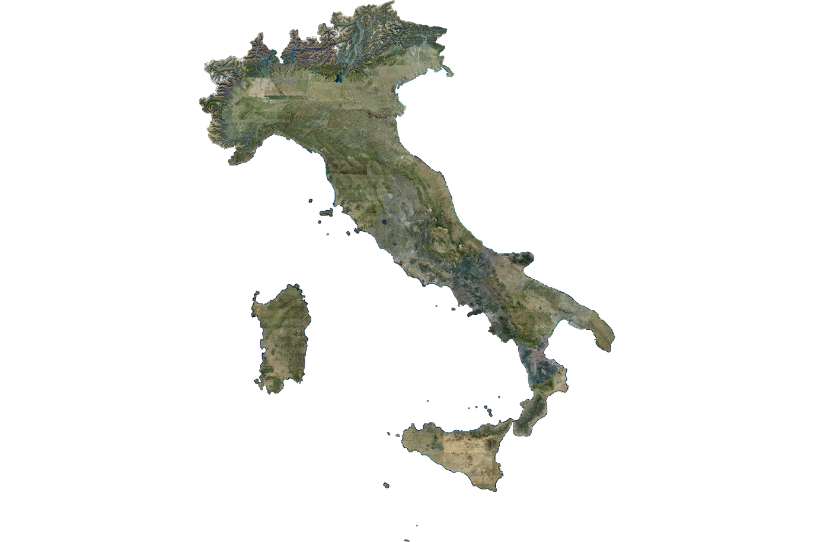

# AGEA Orthophoto Mosaic of Italy (2022-2024)

A seamless, country-wide aerial orthophoto mosaic of Italy, readable directly
from object storage as a single cloud-native Zarr v3 array.



## What is here

One dataset: every AGEA national orthophoto flight from 2022, 2023 and 2024,
merged into one continuous RGBA grid in EPSG:3857 at 0.597 m per pixel. The
array is `(band, y, x)` `uint8` with twelve pyramid levels, from full
resolution down to about 1.2 km per pixel, so a client can read a city block
or the whole country from the same store.

Where flights overlap, the mosaic takes 2024 first, then 2023, then 2022.
Neighbouring areas therefore often come from different years. The mosaic is
not radiometrically balanced, so colour steps at region boundaries are the
data rather than a rendering fault; they are visible in the thumbnail above.

The alpha band is the coverage mask. It is 0 over the sea, over neighbouring
countries, and over the padding at the edge of the stored grid. Measured on
pyramid level 11, 25.4 percent of the grid carries imagery.

Two limits are worth knowing before you plan work around this data. The pixel
values are rendered 8-bit display tiles from AGEA's web map service, not
calibrated reflectance, so they do not support quantitative radiometry. And
although AGEA produces the orthophotos at 20 cm, this mosaic comes from the
Web Mercator tile service, whose finest zoom is about 40 to 48 cm on the
ground in Italy. Basilicata is coarser again, available only at about 180 cm
and upsampled four times. For full 20 cm detail, go to the
[Geoportale AGEA](https://geoportale.agea.gov.it/).

## License

**CC-BY-4.0**. The orthophotos are produced and owned by AGEA and published by
AGEA under the
[Creative Commons Attribution 4.0 International licence](https://creativecommons.org/licenses/by/4.0/).
MindEarth released the derived Zarr dataset under the same licence. The
original AGEA terms are at
<https://geoportale.agea.gov.it/legal-notes>.

Credit both AGEA as the source and MindEarth as the producer of the derived
dataset. MindEarth's required attribution string is:

> Contains orthophotos © AGEA – Agenzia per le Erogazioni in Agricoltura,
> voli 2022–2024, CC BY 4.0, modified by MindEarth.

AGEA does not endorse this dataset or any use made of it. Both the source data
and the derived dataset are provided as is, with no guarantee of accuracy,
completeness, currency or fitness for a particular purpose.

## Provenance

**This collection is a mirror.** It is metadata only. It describes bytes that
MindEarth hosts on Source Cooperative, links to them by absolute URL, and
copies none of them.

The chain runs in three steps:

1. **AGEA** flew and produced the national orthophotos at 20 cm, in the 2022,
   2023 and 2024 campaigns, and published them through public WMTS services
   on the [Geoportale AGEA](https://geoportale.agea.gov.it/). The Italian
   National Spatial Data Catalogue lists those services as the official
   distribution resources, under records `agea:OI:ORTOIMMAGINI:m004`, `m005`
   and `m006`. The source datasets fall within Commission Implementing
   Regulation (EU) 2023/138 on High-Value Datasets, geospatial category.
2. **MindEarth** retrieved the tiles between 2026-09-01 and 2026-10-15 at zoom
   level 18, merged them into one priority mosaic, converted the result to a
   sharded Zarr v3 array, and published it at
   [source.coop/mindearth/italy-aerial](https://source.coop/mindearth/italy-aerial).
   Their own documentation is carried here as the `source-readme` asset.
3. **This catalog** describes that store in STAC. It was synced on 2026-10-31
   and has no automatic sync: the `updated` field records the last time a
   person checked it against the upstream.

The `zarr-metadata` and `source-readme` assets carry `file:checksum` values
taken at sync time. A mismatch means MindEarth has republished and this
catalog needs re-checking.

## Access

Source Cooperative serves no directory listing over plain HTTP, so an HTTP
Zarr store fails here. Open the store through an S3-style store, which works
anonymously and needs no credentials.

```python
import xarray as xr
from obstore.store import S3Store
from zarr.storage import ObjectStore

store = ObjectStore(
    S3Store(
        "mindearth",
        prefix="italy-aerial/italy-aerial.zarr",
        endpoint="https://data.source.coop",
        region="eu-central-1",
        skip_signature=True,
        virtual_hosted_style_request=False,
    ),
    read_only=True,
)

rgba = xr.open_zarr(store, group="0", consolidated=False)["rgba"]
print(rgba.shape)   # (4, 2899968, 2244608)
```

Nothing downloads until you compute. Group `0` is full resolution; groups `1`
to `11` are the pyramid levels.

For bounding-box reads, level selection, the descending y axis, and the
padding trap, read the [collection agent guide](AGENTS.md). Every recipe in it
has been run against the published store.

MindEarth also hosts a browser preview in their
[Zarr viewer](https://mindearth.github.io/zarr-viewer/?p=rgb-multiscale&url=https%3A%2F%2Fdata.source.coop%2Fmindearth%2Fitaly-aerial%2Fitaly-aerial.zarr).
